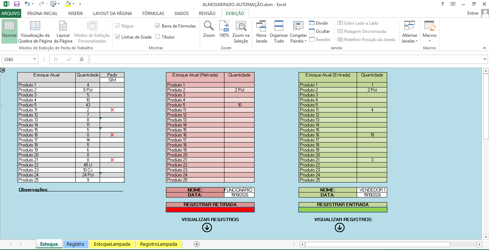
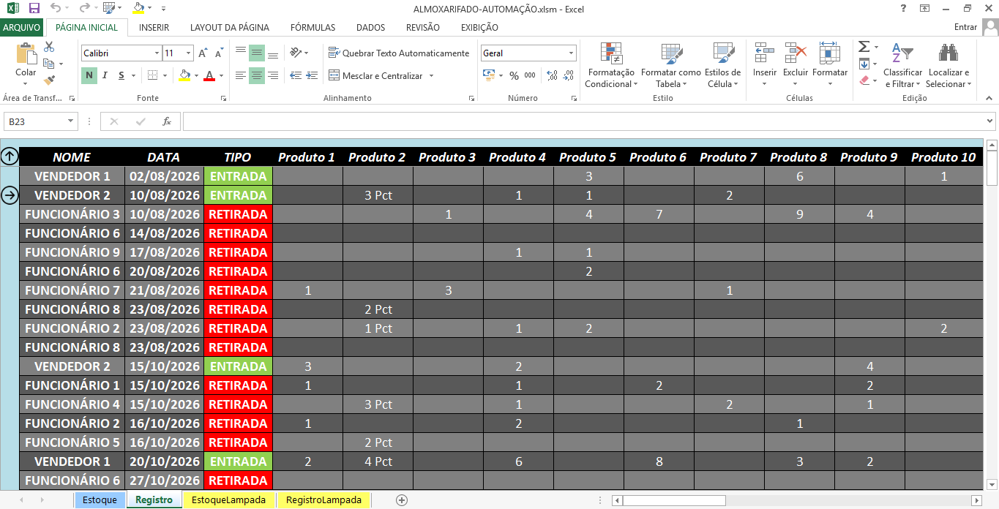

# 📦 Sistema de Controle de Estoque com Excel e VBA

**Automação de processos administrativos e gerenciamento de movimentações de estoque utilizando Microsoft Excel, VBA e fórmulas.**

Este projeto consiste em uma solução de controle de estoque desenvolvida com Microsoft Excel e VBA (Visual Basic for Applications), com o objetivo de automatizar o registro de entradas e retiradas de materiais, atualizar quantidades disponíveis e manter um histórico organizado das movimentações.

A aplicação foi inspirada em uma necessidade prática de controle de materiais em um ambiente administrativo, demonstrando como a programação e a automação de planilhas podem contribuir para otimizar processos, reduzir tarefas manuais e melhorar a organização das informações.

Este repositório disponibiliza uma versão demonstrativa do projeto, com dados fictícios e sem informações internas ou registros reais da organização onde surgiu a ideia.

---

## 🛠️ Tecnologias e Ferramentas

- **Microsoft Excel** — Estruturação das planilhas, organização e apresentação dos dados.
- **VBA (Visual Basic for Applications)** — Desenvolvimento de macros e automação dos processos.
- **Fórmulas e funções do Excel** — Cálculos, atualização de informações e identificação de situações que exigem reposição.
- **Macros** — Execução automatizada de operações de entrada e retirada de materiais.

---

## 🚀 Funcionalidades

O sistema foi desenvolvido para simplificar as operações de controle de estoque, automatizando tarefas e aplicando validações durante o registro das movimentações.

### 📥 Registro de Entradas
- Registro das quantidades recebidas.
- Identificação do responsável pela operação.
- Atualização automática das quantidades disponíveis.
- Registro da movimentação no histórico correspondente.

### 📤 Registro de Retiradas
- Registro das quantidades retiradas.
- Identificação do responsável pela operação.
- Atualização automática do saldo disponível.
- Verificação da disponibilidade antes de confirmar a retirada.

### 🔒 Validações e Consistência dos Dados
- Bloqueio de quantidades negativas.
- Verificação da disponibilidade de materiais antes das retiradas.
- Validações dos campos utilizados nas operações.
- Verificação das condições necessárias para registrar movimentações.

### 📋 Histórico de Movimentações
- Registro do responsável pela operação.
- Armazenamento da data da movimentação.
- Identificação do tipo de operação (entrada ou retirada).
- Registro das respectivas quantidades movimentadas.
- Separação dos históricos conforme a categoria de material.

### ⚠️ Alertas de Reposição
- Identificação de materiais com estoque abaixo dos limites estabelecidos.
- Utilização de fórmulas do Excel para sinalizar a necessidade de reposição.

### ⚙️ Automação de Processos
- Limpeza automática dos campos após o registro.
- Atualização das informações do estoque.
- Organização dos registros por categorias de materiais.

---

## 🏗️ Organização do Projeto

O repositório está organizado para separar o código-fonte, a documentação e os arquivos necessários para demonstrar e utilizar a solução.

```text
controle-estoque-excel-vba/
│
├── docs/
│   ├── imagens/
│   │   ├── estoque.png
│   │   └── historico.png
│   │
│   └── exemplos/
│       ├── controle-estoque-demonstracao.xlsm
│       └── instrucoes.md
│
├── src/
│   └── Código-fonte VBA
│
└── README.md
```

### 📂 `src/`
Contém os códigos-fonte desenvolvidos em VBA, permitindo consultar a implementação das macros e compreender a lógica utilizada na automação das operações.

### 📂 `docs/`
Concentra os materiais de documentação e demonstração do projeto.

- **`imagens/`**: capturas de tela das planilhas de controle e dos históricos de movimentações.
- **`exemplos/`**: arquivo demonstrativo da planilha e instruções para utilização.

---

## 📸 Demonstração

### 📦 Controle de Estoque

Visualização das quantidades disponíveis e das áreas destinadas ao registro de entradas e retiradas de materiais.



### 📋 Histórico de Movimentações

Registro das operações realizadas, permitindo acompanhar informações como responsável, data, tipo de movimentação e quantidades.



---

## 🧠 Conceitos e Conhecimentos Aplicados

Durante o desenvolvimento do projeto, foram aplicados conceitos de programação e automação, incluindo:

- Lógica de programação.
- Estruturas condicionais e de repetição.
- Modularização e organização de código VBA.
- Manipulação de planilhas e células por meio do VBA.
- Validação e consistência de dados.
- Automatização de tarefas repetitivas.
- Manipulação e atualização de registros.
- Organização e rastreabilidade de informações.
- Integração entre macros e fórmulas do Excel.

---

## ▶️ Como Executar o Projeto

### Pré-requisitos

- Microsoft Excel para Windows com suporte a macros VBA.
- Arquivo demonstrativo `controle-estoque-demonstracao.xlsm`.

### 1. Obtenha o projeto

Clone o repositório:

```bash
git clone https://github.com/MatheusHLT/controle-estoque-excel-vba.git
```

Ou baixe diretamente o arquivo demonstrativo disponibilizado no repositório.

### 2. Abra a planilha

Abra o arquivo `controle-estoque-demonstracao.xlsm` utilizando o Microsoft Excel para Windows.

### 3. Habilite as macros, se necessário

As macros são necessárias para executar os botões de registro e as operações automatizadas.

Leia os avisos de segurança apresentados pelo Excel antes de permitir a execução do conteúdo ativo.

### 4. Explore as funcionalidades

Consulte as abas da planilha para testar os registros de entradas, retiradas e históricos utilizando os dados fictícios disponibilizados.

**📖 Documentação:** consulte o arquivo [Instruções de Utilização](docs/exemplos/instrucoes.md) para obter orientações detalhadas sobre o funcionamento da planilha.

**🔎 Código-fonte:** os códigos VBA podem ser consultados na pasta `src/`.

---

## ⚠️ Observações Importantes

- Este projeto possui finalidade demonstrativa e educacional.
- A planilha utiliza dados fictícios, sem informações reais ou internas da organização onde foi desenvolvida a solução original.
- Habilite macros somente em arquivos cuja origem e código tenham sido verificados.
- Não desative globalmente as proteções de segurança do Excel para executar o projeto.
- A versão demonstrativa não deve ser utilizada para controlar estoques reais sem testes, validações e adaptações adequadas.

---

## 🎯 Objetivos de Aprendizado

Este projeto também faz parte da minha evolução na área de tecnologia, com foco em aplicar conhecimentos de programação para solucionar problemas práticos.

Entre os principais objetivos estão:

- Desenvolver habilidades de programação utilizando VBA.
- Compreender a automação de processos por meio do Excel.
- Aplicar lógica de programação em situações práticas.
- Trabalhar com validação e manipulação de dados.
- Desenvolver soluções que contribuam para a organização de processos administrativos.
- Explorar a integração entre ferramentas de produtividade e programação.

---

## 👨‍💻 Autor

**Matheus Honorato**

Estudante de Sistemas de Informação na UniBH, interessado em desenvolvimento de software, automação de processos, programação e tecnologias Microsoft, especialmente C#, .NET, Python, Java e VBA.

- **GitHub:** [MatheusHLT](https://github.com/MatheusHLT)
- **LinkedIn:** [Matheus Honorato](https://www.linkedin.com/in/matheus-honorato-lt/)
