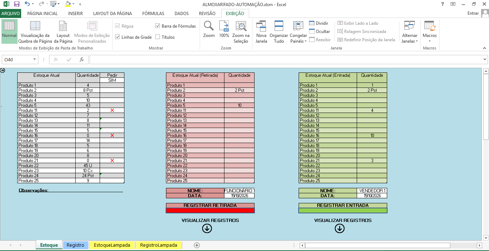
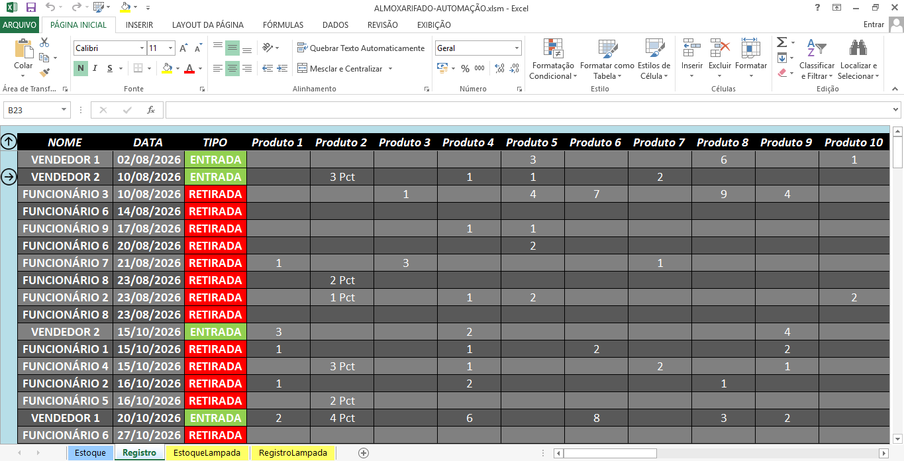

# 📦 Sistema de Controle de Estoque com Excel e VBA

## 📌 Sobre o projeto

Projeto de automação de controle de estoque desenvolvido com Microsoft Excel, VBA e fórmulas, com o objetivo de facilitar o registro de entradas e retiradas de produtos, atualizar quantidades disponíveis e manter um histórico das movimentações.

A solução foi inspirada em uma necessidade prática de controle de materiais e demonstra como a automação de tarefas em planilhas pode contribuir para a organização de processos administrativos.

Este repositório apresenta uma versão demonstrativa, sem dados reais ou informações internas da organização.

## ⚙️ Funcionalidades

- **Registro de entradas:** adiciona quantidades ao estoque e registra a movimentação.
- **Registro de retiradas:** desconta as quantidades retiradas do estoque.
- **Validação de quantidades:** impede valores negativos e verifica a disponibilidade antes de realizar retiradas.
- **Histórico de movimentações:** registra responsável, data, tipo de operação e quantidades movimentadas.
- **Alertas de reposição:** utiliza fórmulas para sinalizar produtos com estoque baixo.
- **Limpeza automática dos campos:** prepara a planilha para a próxima operação após o registro.
- **Controle de diferentes categorias de materiais:** organiza os registros em áreas específicas da planilha.

## 📸 Demonstração

### Tela de controle de estoque

### Histórico de movimentações

## 🛠️ Tecnologias utilizadas

- Microsoft Excel
- VBA (Visual Basic for Applications)
- Fórmulas e funções do Excel
- Macros para automação de processos

## 🧠 Conhecimentos aplicados

- Lógica de programação
- Estruturas condicionais e de repetição
- Manipulação de planilhas por meio do VBA
- Validação de dados
- Automatização de tarefas repetitivas
- Registro e organização de informações

## ▶️ Como utilizar

A versão demonstrativa da planilha poderá ser utilizada no Microsoft Excel para Windows com suporte a macros, após habilitação consciente das macros do arquivo.

O código-fonte VBA pode ser consultado na pasta `src/`.

**Atenção:** habilite macros somente em arquivos de origem confiável. Este projeto não deve ser utilizado para controlar estoque real sem testes e validações adequados.

## 📥 Planilha demonstrativa

[Baixar a planilha Excel (.xlsm)](docs/exemplos/controle-estoque-demonstracao.xlsm)

Consulte também as [instruções de utilização](docs/exemplos/instrucoes.md).

## 👨‍💻 Autor

**Matheus Honorato**

Estudante de Sistemas de Informação no Centro Universitário de Belo Horizonte (UniBH), com interesse em desenvolvimento de software, automação de processos e tecnologia.

- GitHub: [MatheusHLT](https://github.com/MatheusHLT)
- LinkedIn: [Matheus Honorato](https://www.linkedin.com/in/matheushonorato-lt/)
